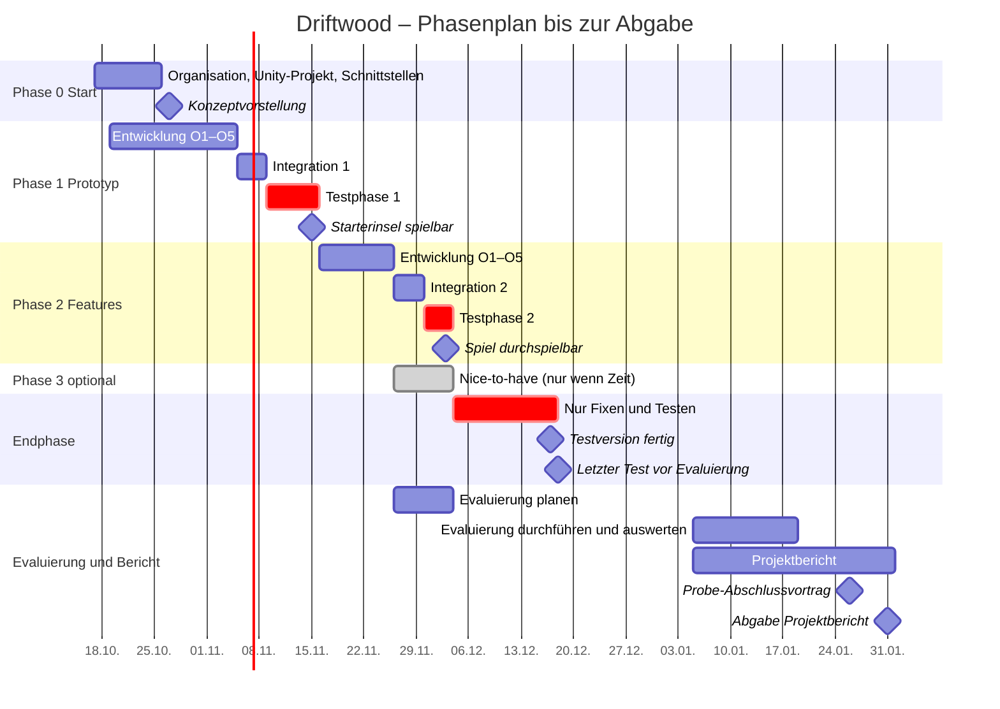

# Roadmap Driftwood

Stand 17.10.2026 (Entwurf). Jede Phase läuft Entwicklung → Integration → Test. Obertasks und Aufgaben stehen in den [Issues](../../issues?q=label%3Aobertask), Termine in den [Meilensteinen](../../milestones).

| Phase | Zeitraum | Meilenstein |
|---|---|---|
| 0 Start | 17.–26.10. | Konzept vorstellen 27.10. |
| 1 Prototyp | Entwicklung 19.10.–04.11., Integration 05.–08.11., Test 09.–15.11. | Starterinsel spielbar 15.11. |
| 2 Features | Entwicklung 16.–25.11., Integration 26.–29.11., Test 30.11.–03.12. | Spiel durchspielbar 03.12. |
| 3 Nice-to-have | nur wenn Phase 2 früher fertig ist, Integration spätestens 03.12. | – |
| Endphase | 04.–17.12., nur Fixen und Testen | Testversion fertig 17.12. |
| Evaluierung und Bericht | ab 05.01.2027 | Abgabe Projektbericht 31.01.2027 |
